# CRUSH : ta calculatrice est une appli de rencontre

**CRUSH remplace l'écran d'accueil de la calculatrice NumWorks (n0110, n0115 ou n0120) par
une appli de rencontre.** Il n'y a plus de menu : chaque appli de la
calculatrice (et chaque jeu `.nwa`) a un **profil** avec sa photo, son âge, sa
bio et ses centres d'intérêt. Tu **swipes**. Un like, c'est un **match**. Le
rendez-vous, c'est l'appli qui s'ouvre.

Et ensuite… les applis t'écrivent. Elles sont jalouses quand tu en ouvres une
autre, elles te ghostent, elles t'appellent, elles peuvent te larguer. Et il y a
un **kit de survie pour les cours** : bouton panique, calculateur d'amour,
générateur d'excuses, faux écran cassé, détecteur de mensonges truqué…


<p align="center">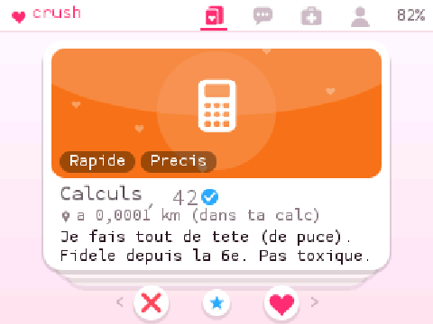</p>

> Au tout premier démarrage, ta calculatrice a l'air **cassée** : écran
> fissuré, encre qui coule, « ERREUR FATALE : ton cœur est vide ». Pas de
> panique, c'est l'intro.

## Ce que fait CRUSH

### Le swipe

- **Une carte par appli** : Calculs (42 ans, « je fais tout de tête, de
  puce »), Fonctions (« j'adore les courbes, les tiennes »), Python
  (`print("célibataire")`), Éléments (13,8 milliards d'années, « on a de la
  chimie, littéralement »)… et chaque jeu `.nwa` avec sa propre icône.
- **◀ NOPE**, **▶ LIKE** (ou OK), **▲ SUPER LIKE** : la carte s'envole avec
  son tampon, la suivante est déjà dessous.
- **Certaines applis refusent le nope** : Calculs et Paramètres reviennent
  en rebondissant (« Calculs refuse le NOPE. Il est indispensable. »).
- **Elles le prennent mal** : après 3 nopes, la bio change (« Tu m'as déjà
  nope 3 fois. Je reviens quand même. ») ; après 6, l'appli **pleure** sur sa
  photo.
- **⌫** annule le dernier nope (« Crush Gold offert »).

### Le match

- **« C'EST UN MATCH ! »** : ton avatar et l'appli se rejoignent, des cœurs
  pleuvent, et vous avez un point commun (« Vous avez 3 dérivées en
  commun »).
- **OK : aller au rendez-vous** : un cœur rose remplit l'écran et l'appli
  s'ouvre. **▶** : lui écrire. **Retour** : continuer à swiper.
- **Super like** : écran « SUPER CRUSH ! » en bleu, ouverture directe.

### Les messages (touche 2)

- Chaque match t'envoie une **phrase d'accroche** de maths
  (« Je suis Na, t'es Cl : ensemble on fait du sel »).
- Tu réponds avec trois choix : **Rendez-vous ?** (ouvre l'appli),
  **un compliment** (+1 cœur) ou **une trahison** (« Désolé, je préfère ma
  TI-83 » : -1 cœur).
- « **en train d'écrire…** » avec les trois petits points, puis la réponse.
- **Jalousie** : ouvre une appli, une autre t'écrit « T'étais avec Python ??
  Je t'ai vu(e). ».
- **Ghosting** : oublie une appli trop longtemps, elle t'écrit « Coucou ? Tu
  m'as ghosté(e) ? », puis juste « Vu à 13h37. ».
- **Rupture** : à 0 cœur, elle **t'unmatch** (« Python t'a unmatch. Bien
  fait. »). Sa carte revient : « On s'est déjà parlé, non ? ».
- **Couple** : à 5 cœurs, elle te demande en couple.
- **Appels entrants** : en revenant d'une appli, une autre t'appelle en
  « appel vidéo Crush ». OK décroche (et l'ouvre), Retour lui raccroche au nez
  (elle s'en souviendra).

<p align="center">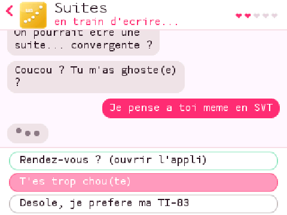</p>

### Le kit de survie en cours (touche 3)

| Outil | Ce qu'il fait |
| --- | --- |
| **Panique** | la touche **0**, n'importe où dans Crush, ouvre l'appli Calculs **instantanément**, sans animation. Le prof ne voit qu'une calculatrice. |
| **Amour %** | tape deux prénoms (les touches tapent directement des lettres, pas besoin d'Alpha) : le cœur se remplit et donne le verdict. Toujours le même résultat pour les mêmes prénoms, dans les deux sens. Un prénom qui contient « prof » : 0 %. |
| **Excuses** | « Je n'ai pas fait mes devoirs parce que ma grand-mère a vendu sur Vinted ma copie pendant une éclipse. » Plus de 5 000 combinaisons, avec leur taux de crédibilité. |
| **Écran cassé** | l'écran d'accueil, fissuré, avec une tache d'encre et des lignes de pixels morts. Chaque touche ajoute un impact. Prête ta calculatrice à ton voisin. |
| **Détecteur** | pose une question, OK : l'aiguille s'affole (« Consultation de ta mère… ») puis rend son verdict. **Le secret** : appuie sur **+** avant OK pour forcer VÉRITÉ, sur **−** pour forcer MENSONGE. Seul un pixel dans le coin te dit que c'est truqué. |
| **Au tableau** | qui passe au tableau ? ◀ ▶ règlent le nombre d'élèves, OK fait tourner la roulette. **Le secret** : tape un numéro avec les chiffres avant de lancer, c'est lui qui sortira. |
| **Fin du cours** | compte à rebours jusqu'à la sonnerie avec le niveau d'ennui (« Tu as relu 4 fois la même ligne », « Ton âme quitte ton corps »…) et une tête qui fond. |
| **Fausse MAJ** | « Mise à jour de Crush 2.0. NE PAS ÉTEINDRE LA CALCULATRICE. » Monte jusqu'à 99 %, recule parfois, ne finit jamais. « Téléchargement de RAM… » |
| **Boule 8** | la boule magique répond à ta question (« Interro surprise demain. », « Ta mère a dit non. »). |

### Le profil (touche 4)

Tes likes, tes nopes, tes matchs, tes ruptures, ton **taux de charme**, ton
statut (« En couple avec Fonctions », « C'est compliqué avec Python »,
« Célibataire (mais motivé) ») et tes badges (« Briseur de cœurs »,
« Cœur d'artichaut », « Traître TI-83 »…).

### Et aussi

- **Thème rose** sur toute la calculatrice : barre de titre des applis,
  sélections, curseur.
- Le logo bat comme un cœur, des petits cœurs flottent sur les photos.
- **Installateurs en un clic pour Mac et pour Windows**, comme pour mes
  autres systèmes.

| | | |
| --- | --- | --- |
| 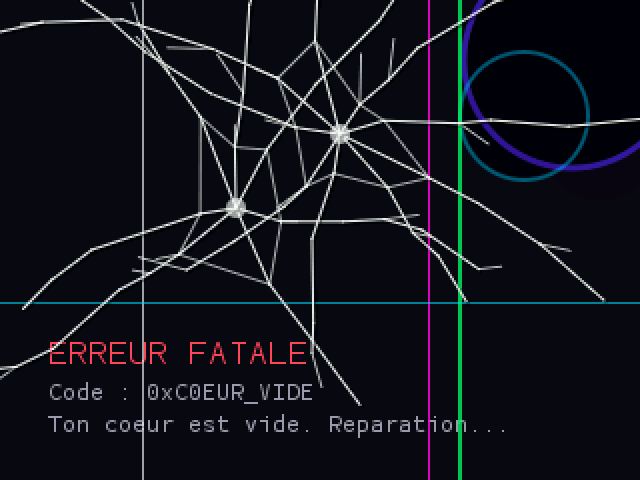 | 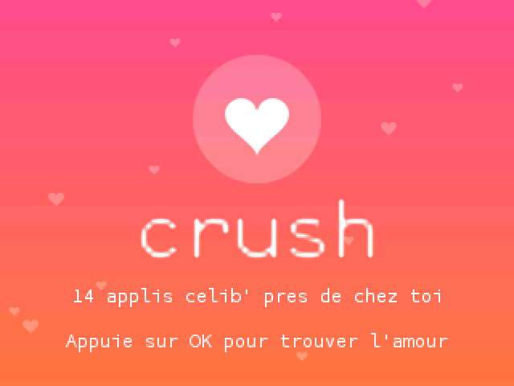 | 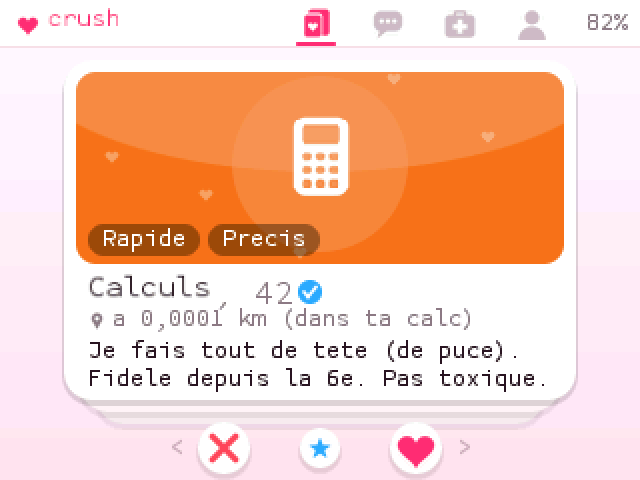 |
| 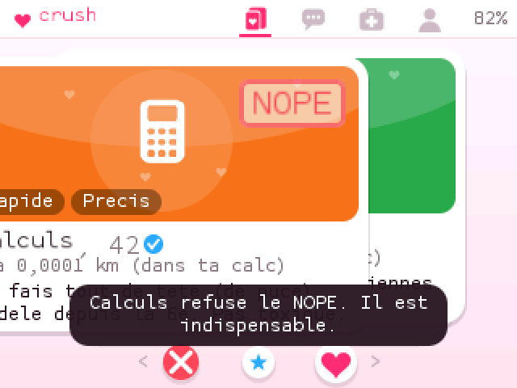 | 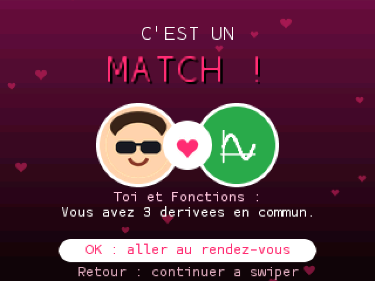 | 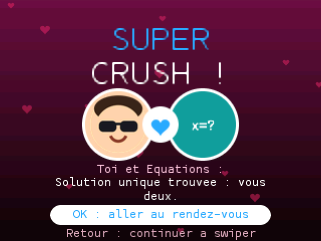 |
| 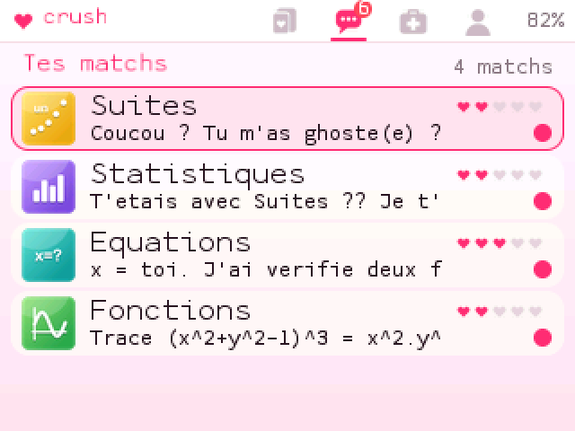 | 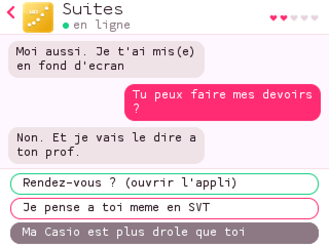 | 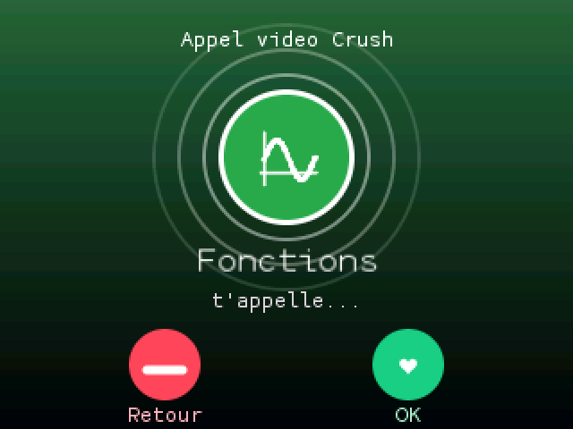 |
| 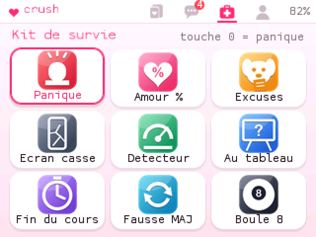 | 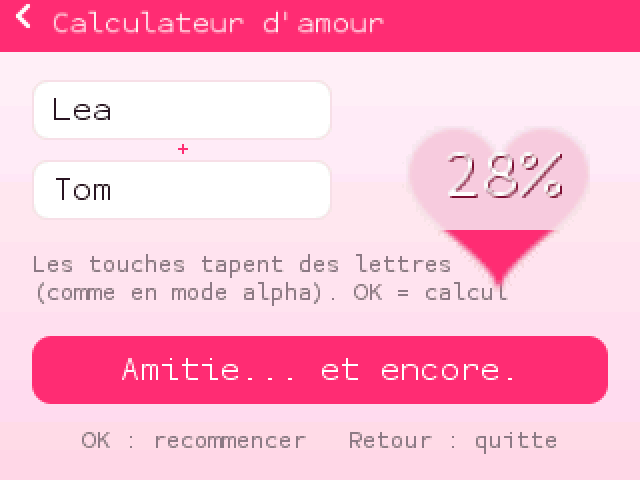 | 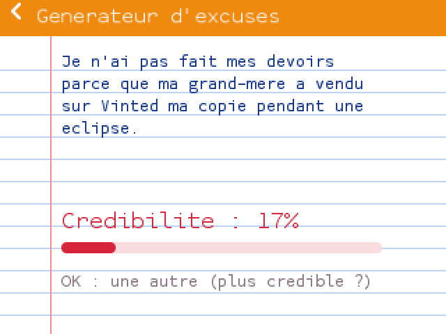 |
| 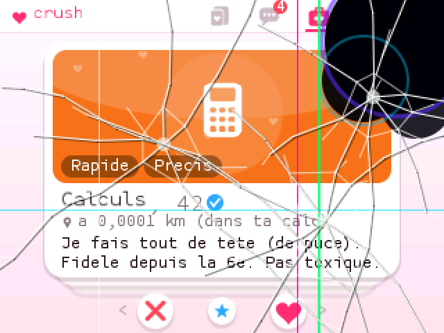 | 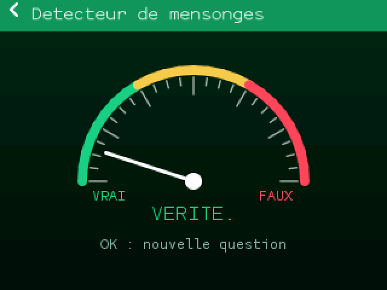 | 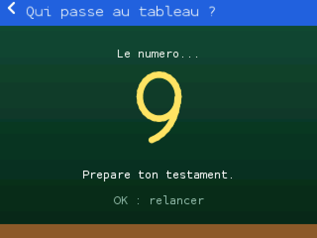 |
| 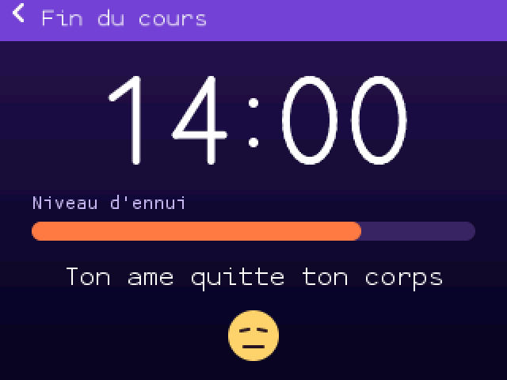 | 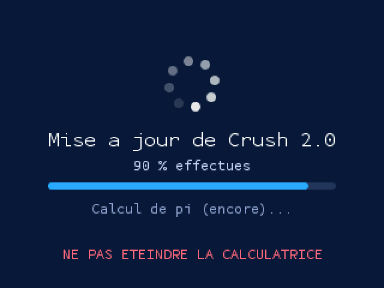 | 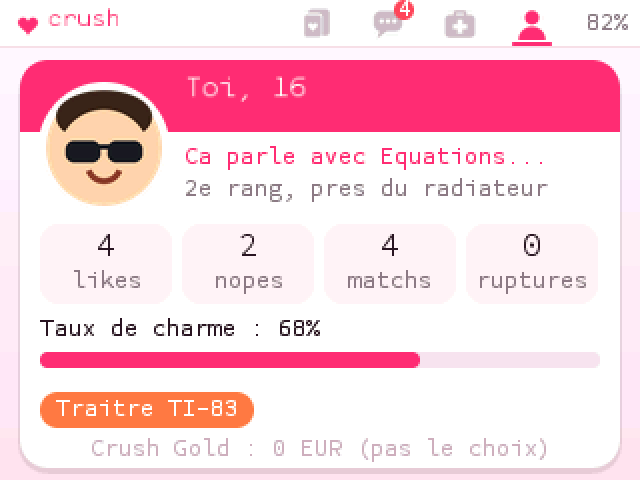 |

## Touches

| Touche | Action |
| --- | --- |
| ◀ / ▶ / ▲ | nope / like / super like (dans les listes : se déplacer) |
| OK ou EXE | like, ouvrir, envoyer, valider |
| 1, 2, 3, 4 | Swipe, Messages, Kit de survie, Profil |
| Outils, Var, Shift + ◀ ▶ | onglet suivant / précédent |
| 0 | **bouton panique** : ouvre Calculs tout de suite |
| ⌫ | annuler le dernier nope |
| Retour | revenir en arrière (au swipe depuis les autres onglets) |

## Installation

### 1. Obtenir CRUSH

Depuis juillet 2021, le code d'Epsilon (le logiciel de la NumWorks) n'est plus
sous licence libre. CRUSH ne publie donc **aucun code ni aucun firmware de
NumWorks** : seulement un **patch** (`patches/crush-os-epsilon.patch`) et son
propre code. Le firmware se compile à partir des sources officielles de
NumWorks, dans ton compte GitHub ou sur ton Mac.

**Sans rien compiler (Mac ou Windows)**

1. En haut de cette page : **Use this template** > **Create a new
   repository**, coche **Private** (obligatoire : la compilation refuse de
   tourner dans un dépôt public, pour que le firmware ne soit pas
   téléchargeable par tous).
2. Facultatif : ajoute tes jeux `.nwa` dans le dossier `games/` de ta copie
   privée (*Add file* > *Upload files*). Chaque jeu devient un profil à
   swiper.
3. Dans ta copie : onglet **Actions** > **Build CRUSH** > **Run workflow**.
4. Environ 30 minutes plus tard (un firmware par modèle), en bas de la page
   de la compilation, télécharge **CRUSH-Mac** ou **CRUSH-Windows** et
   décompresse-le (deux fois pour la version Mac : GitHub met le zip dans un
   zip).

**En compilant sur ton Mac**

```bash
brew install make dfu-util libusb
brew install --cask gcc-arm-embedded
git clone https://github.com/derim00/crush-os.git && cd crush-os
./scripts/build-firmware.sh
```

Le script télécharge Epsilon au commit indiqué dans `EPSILON_COMMIT`,
applique le patch, compile, prépare les jeux de `games/` et remplit le
dossier `installer/`.

### 2. Installer sur la calculatrice

**Sur Mac**

1. Une seule fois : `brew install libusb dfu-util` (et
   `brew install --cask gcc-arm-embedded` pour ajouter d'autres jeux).
2. Double-clique sur **`Installer CRUSH.command`** (la première fois :
   clic droit > **Ouvrir**). La page de l'installateur s'ouvre
   (http://127.0.0.1:8781).

**Sur Windows** (rien à installer : ni Python, ni pilote)

1. Décompresse **CRUSH-Windows** (clic droit > *Extraire tout*).
2. Double-clique sur **`Installer CRUSH.exe`** (si SmartScreen s'affiche :
   *Informations complémentaires* > *Exécuter quand même*). Laisse la
   fenêtre noire ouverte, ferme-la à la fin pour quitter.

**Ensuite, sur les deux**

3. Branche la calculatrice en USB et appuie sur **Reset** au dos : elle
   redémarre sur le système officiel.
4. Quand le voyant passe au vert, glisse tes jeux `.nwa` dans la page si tu
   veux, puis clique sur **Installer CRUSH**.

Seul le **slot B** est écrit : le système officiel (slot A) n'est jamais
modifié.

## À savoir

- **Calculatrice** : NumWorks **n0110**, **n0115** ou **n0120**, logiciel
  officiel **26.4.0** dans le slot A. L'installateur choisit tout seul le
  firmware du modèle branché.
- **Un seul système dans le slot B** : CRUSH remplace PS5-OS, Switch-OS,
  NUMAGOTCHI… (et inversement). Les installateurs peuvent tourner en même
  temps (CRUSH utilise le port 8781).
- **Mémoire** : tes matchs, conversations et statistiques restent tant que la
  calculatrice ne redémarre pas. Après un Reset, tout le monde redevient
  célibataire (et le faux crash revient).
- **Mode examen** : les jeux sont refusés (« pas de rdv »), et Python,
  Éléments ou Équations suivent les règles de l'examen comme d'habitude.
- **Accents** : la police de la NumWorks n'a pas de lettres accentuées ; les
  textes s'affichent sans accents.
- **Home et On/Off** : le correctif du plantage Home / On-Off de Windows-OS
  est repris. Home ramène toujours à l'écran d'accueil.
- **Jeux** : seulement des applis `.nwa` dont tu as le droit de te servir, et
  uniquement dans ta copie privée : jamais dans un dépôt public.
- **À utiliser avec modération en cours.** Le bouton panique ne te sauvera
  pas à tous les coups.

## Comment c'est fait

| Fichier (dans le patch) | Rôle |
| --- | --- |
| `apps/home/ds/shell.cpp` | toute l'appli : faux crash, swipe, profils, match, messages, jalousie, ghosting, appels, kit de survie, profil et toutes les animations |
| `apps/home/ds/gfx.cpp` | rendu par bandes en RAM (repris de mes autres systèmes), images avec transparence, texte, formes arrondies, traits antialiasés, icônes agrandies |
| `apps/home/ds/gen_icons.py` | dessine les symboles des applis, les icônes du kit de survie, les cœurs, les onglets et ton avatar dans `ds_icons.h` |
| `apps/home/controller.cpp` | relie l'accueil à Escher et dessine les animations directement à l'écran |
| `escher/include/escher/palette.h`, `theme/light_theme.h` | le thème rose de toute la calculatrice |
| `escher/src/run_loop.cpp` | animations : l'appli d'accueil peut demander une image toutes les 40 ms |
| `scripts/photos.py` | transforme la séance photo du simulateur (`DS_SHOTS=dossier`) en PNG et GIF |

## Licence

Le code de CRUSH est sous licence **CC BY-NC-SA 4.0** (voir `LICENSE`).
Epsilon reste la propriété de NumWorks et n'est pas inclus dans ce dépôt.
Les icônes, l'avatar et les images sont des dessins originaux. CRUSH est une
parodie d'appli de rencontre, sans lien avec NumWorks ni avec aucune appli de
rencontre existante.
